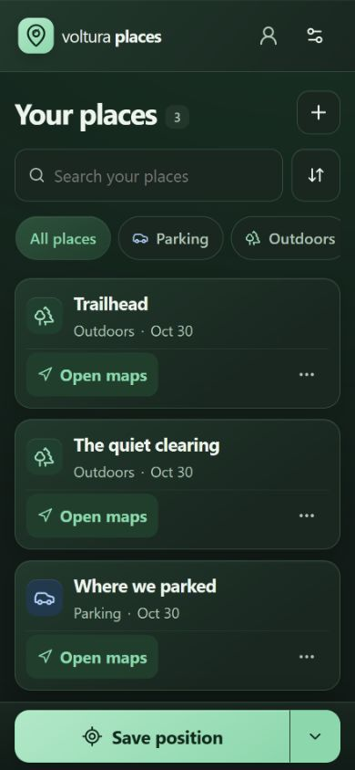

# Voltura Places

**Save a place. Find your way back.** A mobile-first location library for the trailhead, the quiet clearing, and where you parked. Freeware with MIT-licensed source. English and Swedish.

Save GPS positions on your device, then name them, choose a category or add a photo. **Save with details** can start from GPS or a photo’s embedded location. Search and filter offline, open Google Maps or Apple Maps, share a snapshot link, and import/export JSON backups. Optional account sync brings places and photos to your other devices when online.

- **Private places and separate groups.** Choose a library before saving. Each group has its own places, photos and members; private places stay private. Copy a private place to a chosen group while keeping the original independent.
- **Invite from inside the app.** In Settings → Family sharing, create a named group and share its four-digit code. The recipient signs in and enters it in their own app; the owner approves the request. Codes remain available until approved or cancelled. One account supports up to 20 groups, with up to 10 members each. Members can add, edit and delete shared places and photos.
- **A readable interface.** Dark by default, with Light/System themes, English/Swedish, category colours and icons, large phone controls, and a desktop details pane.
- **Offline and recovery.** Saves commit locally before success. Signed-in changes sync when online. Settings → Backup offers device-storage retention and JSON backups; browser data can still be cleared, so keep exports. Downloaded group copies remain readable/exportable after access ends.
- **Install from your browser.** iPhone: Safari → Share → Add to Home Screen. Android: browser menu → Install app / Add to home screen. No app store, paid map API or runtime AI service.



App: https://places.voltura.se/ · About: https://voltura.se/places/

## Develop

```sh
npm ci
npm run setup
npm run dev
```

Node 24 LTS and npm 12. `npm run dev` runs the local API/built app with local D1 on port 5174. For visual review, run `npm run dev:ui` and always use http://127.0.0.1:5173/. It updates live with changes in this checkout and reuses an existing matching preview. If another app or checkout owns the port, startup reports a conflict instead of selecting a different port. Local sign-in needs explicit local configuration; no real email is sent by tests.

The optional Wrangler database explorer is disabled because this pinned release omits its UI bundle; local D1 and the app remain available.

```sh
npm run check
npm test
npm run build
npm run test:api
npm run test:auth
npm run test:browser
```

See [documentation](docs/README.md). Browser-local data can be cleared/evicted; account sync and exports provide recovery. Shared links and exports contain location data.

## Publish

`npm run publish` checks and publishes the exact clean-main commit through Sites. `npm run publish:promo -- --dry-run` reviews the one.com upload list without connecting. Public GitHub owns reviewed source; Sites keeps its deployment source mirror. The promo publisher cannot write outside `/places/`.

Sites is currently included with eligible OpenAI subscriptions during public beta, subject to usage limits and future policy. No additional services or credits are purchased by the scripts.
